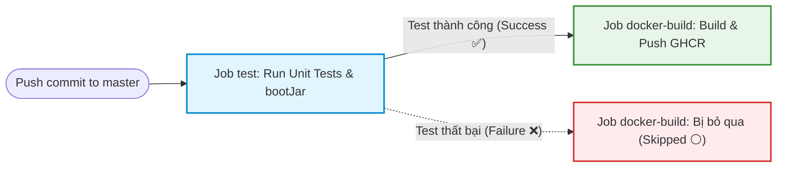

# Bài tập 5: Nối Job tự động Build & Push Docker Image sau khi Test Gradle xanh

## 1. Mục tiêu
- **Tách luồng CI thành 2 Job riêng biệt:**
  - `test`: Chạy JUnit test và đóng gói ứng dụng Spring Boot thành tệp JAR (`./gradlew bootJar`), upload thành phẩm JAR dưới dạng Artifact.
  - `docker-build`: Tải JAR Artifact về, đăng nhập GitHub Container Registry (GHCR) và đóng gói đẩy Docker Image.
- **Ràng buộc thứ tự thực thi bằng từ khóa `needs: test`:** Đảm bảo chỉ thực hiện build và push Docker Image khi toàn bộ bài test kiểm thử chất lượng mã nguồn thành công (màu xanh).

---

## 2. Sơ đồ luồng thực thi (Workflow DAG)



---

## 3. Cấu hình kịch bản CI (`.github/workflows/ci.yml`)

```yaml
name: Java Spring Boot CI (Gradle)

on:
  push:
    branches: [ "master", "main" ]

permissions:
  contents: read
  packages: write

jobs:
  # ==========================================================
  # JOB 1: Kiểm thử mã nguồn và đóng gói tệp JAR
  # ==========================================================
  test:
    name: Run Unit Tests
    runs-on: ubuntu-latest

    steps:
      - name: Checkout mã nguồn
        uses: actions/checkout@v4

      - name: Thiết lập môi trường Java JDK 21
        uses: actions/setup-java@v5
        with:
          java-version: '21'
          distribution: 'temurin'
          cache: 'gradle'

      - name: Cấp quyền cho Gradle Wrapper
        run: chmod +x gradlew

      - name: Thực thi JUnit Test với Gradle
        run: ./gradlew test

      - name: Đóng gói tệp JAR với Gradle
        run: ./gradlew bootJar

      - name: Lưu trữ thành phẩm JAR Artifact
        uses: actions/upload-artifact@v4
        with:
          name: app-jar
          path: build/libs/*.jar

  # ==========================================================
  # JOB 2: Đóng gói Docker Image và Push lên GitHub Container Registry
  # ==========================================================
  docker-build:
    name: Build and Push Docker Image
    needs: test # Ràng buộc: Chỉ chạy khi job 'test' hoàn thành thành công
    runs-on: ubuntu-latest

    steps:
      - name: Checkout mã nguồn
        uses: actions/checkout@v4

      - name: Tải về JAR Artifact từ Job test
        uses: actions/download-artifact@v4
        with:
          name: app-jar
          path: build/libs

      - name: Thiết lập Docker Buildx
        uses: docker/setup-buildx-action@v3

      - name: Đăng nhập vào GitHub Container Registry
        uses: docker/login-action@v3
        with:
          registry: ghcr.io
          username: ${{ github.actor }}
          password: ${{ secrets.REGISTRY_TOKEN }}

      - name: Chuyển tên repository sang chữ thường
        run: |
          echo "IMAGE_NAME=ghcr.io/$(echo '${{ github.repository }}' | tr '[:upper:]' '[:lower:]')" >> $GITHUB_ENV

      - name: Đóng gói và đẩy Docker Image lên GHCR
        uses: docker/build-push-action@v5
        with:
          context: .
          push: true
          tags: |
            ${{ env.IMAGE_NAME }}:latest
            ${{ env.IMAGE_NAME }}:${{ github.sha }}
```

---

## 4. Tệp Dockerfile (`Dockerfile`)

Sử dụng base image JRE 21 Eclipse Temurin phiên bản Alpine siêu nhẹ để tối ưu kích thước image và tốc độ triển khai:

```dockerfile
FROM eclipse-temurin:21-jre-alpine
WORKDIR /app
COPY build/libs/*.jar app.jar
EXPOSE 8080
ENTRYPOINT ["java", "-jar", "app.jar"]
```

---

## 5. Cơ chế hoạt động của từ khóa `needs: test`

1. **Khi Job `test` thành công (Success):**
   - GitHub Actions chuyển trạng thái của Job `docker-build` từ `Queued` sang `In Progress`.
   - Job `docker-build` tải lại file `.jar` đã được build từ Job 1 mà không cần biên dịch lại từ đầu.
   - Tiến hành build Docker image và đẩy lên GitHub Packages (`ghcr.io`).

2. **Khi Job `test` thất bại (Failure):**
   - Nếu có bất kỳ test case JUnit nào bị `FAILED` (hoặc lỗi biên dịch), Job `test` dừng lại và báo đỏ.
   - Nhờ có ràng buộc `needs: test`, Job `docker-build` ngay lập tức chuyển sang trạng thái **Skipped** (Bị bỏ qua, biểu tượng vòng tròn xám/trắng).
   - Điều này đảm bảo an toàn tuyệt đối: **Không bao giờ đóng gói hoặc phát hành Docker Image chứa mã nguồn lỗi**.

---

## 6. Bằng chứng nộp bài (Evidence & Screenshots)

### 6.1. Ảnh chụp màn hình biểu đồ Workflow hiển thị sơ đồ 2 Job kết nối thành công (`needs: test`)
> Mũi tên liên kết từ Job **Run Unit Tests** $\rightarrow$ Job **Build and Push Docker Image**:


### 6.2. Ảnh chụp màn hình kiểm tra trường hợp Test lỗi khiến Job Docker Image bị `Skipped`
> Thể hiện cơ chế bảo vệ của `needs: test` khi Job 1 thất bại:


